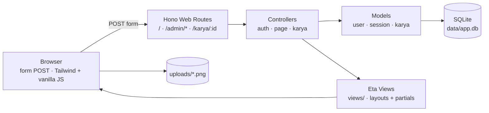

# CoSign

> Platform portofolio anak Creative Media (CM) — share karya, explore karya
> teman, dan bangun identitas angkatan. Terinspirasi dari
> [blush.design](https://blush.design/).


---

## Latar Belakang

Anak Creative Media butuh tempat untuk memamerkan karya dan membangun identitas
angkatan. CoSign menjawabnya dengan cara ala **blush.design**: setiap karya bisa
disusun dari **bagian-bagian gambar** (kepala, badan, background) yang di-upload
dan bisa digabung/di-custom menjadi satu komposisi — lalu di-explore dan
di-like oleh teman.

## Arsitektur

Server-rendered MVC (gaya Laravel): Hono controller mengembalikan **view Eta**
(HTML), semua submit via **form POST** + redirect (PRG). Tidak ada JSON API
terpisah. Gambar part disimpan di `uploads/` dan di-serve statis.



**Keamanan terpasang:** cookie session `httpOnly` + `sameSite=Lax`, password
di-hash argon2 (`Bun.password`), `hono/csrf` (origin) di semua request,
escape default Eta (`<%=`), validasi upload (hanya gambar, maks 20MB).

---

## Struktur Repository (MVC)

```
cosign/
├── src/
│   ├── index.ts                # entry: server Bun (port 3000, hot reload)
│   ├── app.ts                  # build Hono app + middleware global + static
│   ├── db.ts                   # koneksi DB (sqlite | supabase) + migrasi
│   ├── view.ts                 # setup Eta + helper view()/redirect()/flash
│   ├── composition.ts          # helper parts per kategori + like count
│   ├── uploads.ts              # validasi & simpan gambar upload (part/avatar)
│   ├── models/                 # MODEL — akses data / query SQL
│   │   ├── user.model.ts       #   users: register, verifyPassword, profil/avatar
│   │   ├── session.model.ts    #   sessions: create/find/delete session cookie
│   │   ├── karya.model.ts      #   karya + karya_parts + likes
│   │   └── comment.model.ts    #   comments: komentar per karya
│   ├── controllers/            # CONTROLLER — form POST → model → view/redirect
│   │   ├── auth.controller.ts  #   /admin/login, /admin/register, /admin/logout
│   │   ├── profil.controller.ts #  /admin/profil — edit profil, bio, avatar
│   │   ├── page.controller.ts  #   GET / (explore), GET /profil/:username
│   │   └── karya.controller.ts #   admin CRUD + parts, publik detail/customizer + like + komentar
│   ├── middleware/
│   │   ├── auth.middleware.ts  # session helpers + requireAuth + guest
│   │   └── locals.middleware.ts # inject user login + flash ke context
│   └── routes/
│       └── web.ts              # router web: pasang controller + injectLocals
├── views/                      # VIEW — template Eta (Blade/EJS-like)
│   ├── layouts/                #   layout admin & homepage
│   ├── partials/               #   navbar, error list, kartu karya ter-layer
│   ├── admin/                  #   tampilan admin (auth + kelola karya/parts)
│   └── homepage/               #   tampilan depan (explore, customizer, profil)
├── public/                     # aset statis (style.css Tailwind, customizer.js)
├── uploads/                    # gambar part hasil upload (di-gitignore)
├── supabase/migrations/        # skema SQL versi Supabase (opsional)
├── test/                       # unit test (`bun test`, SQLite in-memory)
└── .github/                    # template issue/PR + CI
```

---

## Quickstart

```bash
bun install
bun run dev        # terminal 1: server di http://localhost:3000 (hot reload)
bun run dev:css    # terminal 2: compile Tailwind (watch)
```

Build CSS produksi: `bun run build:css` — hasilnya `public/style.css`.

---

## Rute

| Method | Path | View / Aksi | Auth |
|--------|------|-------------|------|
| GET | `/` | `homepage/index` — explore (filter kategori) | - |
| GET | `/health` | health check | - |
| GET | `/karya/:id` | `homepage/karya` — detail + customizer + komentar | - |
| POST | `/karya/:id/like` | toggle like | ✓ |
| POST | `/karya/:id/comments` | tambah komentar | ✓ |
| POST | `/karya/:id/comments/:cid/delete` | hapus komentar (penulis / pemilik karya) | ✓ |
| GET | `/profil/:username` | `homepage/profil` — profil publik | - |
| GET | `/admin/login` | `admin/auth/login` | guest |
| POST | `/admin/login` | login → `/admin/karya` | guest |
| GET | `/admin/register` | `admin/auth/register` | guest |
| POST | `/admin/register` | buat user → `/admin/karya` | guest |
| POST | `/admin/logout` | logout → `/` | ✓ |
| GET | `/admin/profil` | `admin/profil/edit` — edit profil | ✓ |
| POST | `/admin/profil` | update full name & bio | ✓ |
| POST | `/admin/profil/avatar` | upload / ganti avatar | ✓ |
| POST | `/admin/profil/avatar/delete` | hapus avatar | ✓ |
| GET | `/admin/karya` | `admin/karya/index` — karya saya + form buat | ✓ |
| POST | `/admin/karya` | buat karya (judul, deskripsi, kategori) | ✓ |
| GET | `/admin/karya/:id` | `admin/karya/show` — kelola parts (2D) | ✓ (owner) |
| POST | `/admin/karya/:id/parts` | upload part gambar (kepala/badan/background) | ✓ (owner) |
| POST | `/admin/karya/:id/parts/:pid/delete` | hapus part | ✓ (owner) |
| GET | `/admin/karya/:id/3d` | `admin/karya/show3d` — kelola asset 3D | ✓ (owner) |
| POST | `/admin/karya/:id/3d` | upload asset 3D (GLB/GLTF/OBJ/FBX/STL/USDZ) | ✓ (owner) |
| POST | `/admin/karya/:id/3d/:aid/delete` | hapus asset 3D | ✓ (owner) |
| POST | `/admin/karya/:id/delete` | hapus karya + semua file part/asset | ✓ (owner) |

Semua mutasi via form POST (PRG). Karya punya `tipe` **2d** (part gambar) atau
**3d** (asset 3D). Upload gambar (part & avatar) divalidasi: hanya
`image/jpeg|png|gif|webp`, maksimal **20MB**. Upload asset 3D divalidasi lewat
ekstensi `glb|gltf|obj|fbx|stl|usdz`, maksimal **50MB**. Semua file disimpan sebagai
`uploads/<uuid>.<ext>`. Kategori part: `kepala`, `badan`, `background`.
Komentar maks 1000 karakter; hanya penulis komentar atau pemilik karya yang
bisa menghapusnya.

---

## Testing

```bash
bun test
```

Unit test pakai `bun test` (folder `test/`). DB test memakai SQLite **in-memory** —
tidak menyentuh `data/app.db`. Cakupan saat ini:

| File | Menguji |
|---|---|
| `test/session.model.test.ts` | create/find/delete session |
| `test/user.model.test.ts` | register, verifyPassword, tanpa bocor hash |
| `test/karya.model.test.ts` | CRUD karya, parts (add/list/find/delete), toggleLike, likeCount |
| `test/web.test.ts` | render view, auth flow, buat karya, upload parts (valid/invalid), owner guard, customizer, like, profil, edit profil/avatar, komentar, filter kategori, cleanup file |

CI otomatis menjalankan `bun test` + `bun run build:css` di setiap push/PR ke
`master`.

---

## Ganti ke Supabase

1. `bun add @supabase/supabase-js`
2. Apply `supabase/migrations/001_init.sql` di Supabase (SQL Editor / `supabase db push`)
3. Copy `.env.example` → `.env`, set:
   ```
   DB_DRIVER=supabase
   SUPABASE_URL=...
   SUPABASE_ANON_KEY=...
   ```

Catatan: route saat ini **sqlite-first**. Saat pindah Supabase, tambahkan branch
`db.supabase` di tiap controller (pola `if (db.sqlite) { ... } else { ... }`).

---

## Roadmap

- **Customizer lanjutan** — posisi/ukuran part tersimpan per karya.
- **Supabase driver** — implementasikan branch `db.supabase` di controller.

Lihat [issue-issue](https://github.com/ccit-venture/cosign/issues) untuk daftar
pekerjaan yang sedang/akan dikerjakan.

---

## Kontribusi

Project ini **open source** — kontribusi sangat terbuka! Cara paling cepat:

1. **Fork** repository
2. Buat branch fitur: `git checkout -b feat/nama-fitur`
3. Jalankan test: `bun test`
4. Buat **Pull Request** dengan mengisi template yang sudah disediakan

Panduan lengkap (fork, sinkron upstream, gaya commit) →
[CONTRIBUTING.md](CONTRIBUTING.md). Sebelum mengubah kode, baca juga
[AGENTS.md](AGENTS.md) untuk konvensi struktur & hal yang sering salah.

Komunitas berpegang pada [Kode Etik](CODE_OF_CONDUCT.md). Untuk masalah
keamanan, jangan buka issue publik — lihat [SECURITY.md](SECURITY.md).

---

## Kontributor

| Kontributor | Peran | Kontribusi |
|-------------|-------|------------|
| [@perogeremmer](https://github.com/perogeremmer) | Maintainer · backend & API | Inisialisasi proyek, refactor server-rendered MVC, karya multi-part ([#7](https://github.com/ccit-venture/cosign/pull/7)) |
| [@afaizulh](https://github.com/afaizulh) | Keamanan, performa & fitur karya | [#8](https://github.com/ccit-venture/cosign/pull/8) tutup timing attack login, migrasi media aman, validasi kategori, N+1, rate limit · [#10](https://github.com/ccit-venture/cosign/pull/10) edit karya + pencarian & sort · [#11](https://github.com/ccit-venture/cosign/pull/11) state like per user + export komposisi PNG · [#12](https://github.com/ccit-venture/cosign/pull/12) tipe karya 2D/3D + upload asset 3D · [#13](https://github.com/ccit-venture/cosign/pull/13) edit profil (bio & avatar) + komentar karya |
| [@nabilalefqi-hash](https://github.com/nabilalefqi-hash) | Hardening & type safety | [#9](https://github.com/ccit-venture/cosign/pull/9) session TTL, body limit upload, validasi username, cache Eta, `bun run typecheck` + CI |

**Institusi:** CEP CCIT-FTUI

---

## Lisensi

MIT License — bebas digunakan dengan menyertakan atribusi.

---

<p align="center">
  <sub>CoSign · Venture Studio CCIT-FTUI</sub>
</p>